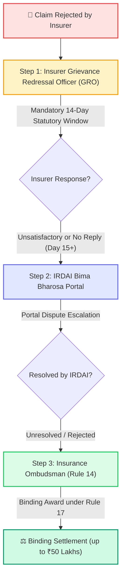
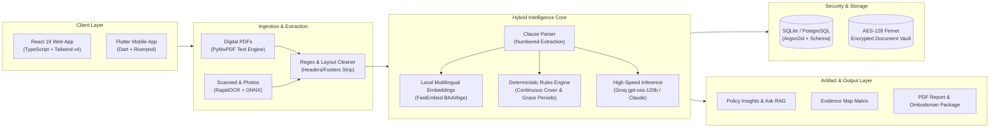

<div align="center">

# 🛡️ ClaimSaathi (क्लेमसाथी)

### *Understand Your Coverage. Defend Your Rights.*

**AI-powered insurance intelligence and dispute resolution platform tailored for Indian policyholders across Health, Motor, and Life insurance.**

[](https://www.python.org/)
[](https://fastapi.tiangolo.com/)
[](https://react.dev/)
[](https://www.typescriptlang.org/)
[](https://tailwindcss.com/)
[](https://flutter.dev/)
[](https://serverpod.dev/)
[](https://groq.com/)
[](https://github.com/RapidAI/RapidOCR)
[](https://pymupdf.readthedocs.io/)
[](https://www.docker.com/)
[](#the-builders-theory-10)
[](#statutory--regulatory-escalation-hierarchy)

[Overview](#-executive-overview) • [Core Capabilities](#-core-capabilities) • [System Architecture](#-system-architecture) • [Demo Case Study](#-the-benchmark-case-study) • [Interactive Demo](#-interactive-demo-no-install-needed) • [API Reference](#-api-reference) • [Getting Started](#-getting-started) • [Deployment](#-docker-container-deployment)

</div>

---

## 📌 Executive Overview

In India, insurance is bought for financial security and peace of mind. Yet, **over 68% of policyholders cannot articulate what their policies actually cover** until they face an unexpected rejection at a hospital billing desk or auto repair workshop.

Policy contracts are 30–80+ page legal documents written in dense legalese, rife with exclusions, co-payments, room-rent proportionate deductions, and conditional waiting periods. When an insurer rejects a claim, policyholders face an overwhelming **information asymmetry**:
- Generic search engines and chat assistants hallucinate clauses or offer vague, un-grounded advice.
- Insurers frequently cite waiting-period clauses calculated from the **most recent renewal date** rather than the **First Policy Date**, unlawfully ignoring accrued continuity benefits.
- Navigating the statutory grievance hierarchy—from the Insurer's Grievance Redressal Officer (GRO) to IRDAI's Bima Bharosa portal and the Insurance Ombudsman—is intimidating, complex, and time-sensitive.

**ClaimSaathi closes this gap.** ClaimSaathi serves as a zero-hallucination, policyholder-first intelligence layer. It extracts and indexes the user's **actual uploaded policy documents**, strictly grounds every insight and answer to exact clauses, computes continuity and waiting periods using a deterministic rules engine, and compiles comprehensive, legally cited grievance packages ready for submission to IRDAI and Ombudsman authorities.

---

## 🏆 The Builder's Theory 1.0

Built with ❤️ by **OverCooked Brains** for *The Builder's Theory 1.0 (Finance & FinTech Track)*.

### Team Members
- **Armaan Khan** (Team Leader)
- **Pranav Pushya**
- **Nandita**
- **Govind**
- **Ryan Sharma**

---

## ⚡ Core Capabilities

ClaimSaathi covers the complete lifecycle of policyholder protection across four functional pillars, complemented by an accessibility-first voice and camera suite:

```
┌───────────────────────────────────────────────────────────────────────────────┐
│                                 CLAIMSAATHI                                   │
├───────────────┬────────────────┬────────────────────────┬─────────────────────┤
│   1. DECODE   │   2. COMPARE   │       3. VERIFY        │       4. ACT        │
│Policy Insights│Scenario Sandbox│Rejection & Evidence Map│Grievance & Redressal│
└───────────────┴────────────────┴────────────────────────┴─────────────────────┘
```

### 1. 🔍 Decode (Policy Insights)
* **Intelligent Document Ingestion**: Ingests digital PDFs, scanned documents, and mobile camera photos of policy wordings, policy schedules, and renewal endorsements.
* **Deterministic Layout & Header Cleanup**: Removes repetitive running headers, footers, and page numbers across all pages without truncating legal provisions.
* **Clause Extraction & Labeling**: Splits contracts into numbered, categorised clauses (Coverage, Exclusions, Limits, Waiting Periods).
* **Plain-Language Multilingual Summaries**: Translates dense legal terms into plain English, Hindi (हिन्दी), or conversational Hinglish.
* **Continuous Coverage Timeline**: Automatically reconstructs the policy timeline (commencement date, renewal milestones, grace periods, and elapsed waiting periods).
* **"Ask ClaimSaathi" RAG**: Interactive policy Q&A grounded exclusively in the policy's extracted clauses. Responses cite exact clause numbers and verbatim text, with zero hallucination.

### 2. ⚖️ Compare (Scenario-Based Policy Testing)
* **Real-World Stress Testing**: Evaluates two policies against real-life medical or vehicular events (e.g., knee replacement in Year 3, 5-day private room hospital stay, flood-induced hydrostatic engine damage) rather than brochure bullet points.
* **Granular Feature Benchmarking**: Side-by-side breakdown comparing Sum Insured, room rent capping, co-payment percentages, waiting periods, maternity coverage, and restoration benefits.
* **Advantage Detection**: Automatically flags which policy performs better for each scenario and highlights key trade-offs.

### 3. 🛡️ Verify (Rejection Check & Evidence Mapping)
* **Denial Letter Decomposition**: Reads insurer rejection letters to extract claim numbers, admitted/disputed amounts, hospital admission dates, and exact clauses cited by the claims assessor.
* **Deterministic Timeline & Continuity Audit**: Uses a rule-based engine to check if waiting-period calculations violate IRDAI continuous coverage mandates (accounting for 30-day renewal grace periods).
* **Clause-to-Claim Evidence Map**: Cross-references insurer allegations against the actual policy clause, customer hospital records, and renewal receipts:
  - 🟢 **Not Supported by Policy**: Insurer grounds contradict policy wording or continuity history.
  - 🟡 **Unclear / More Information Needed**: Missing doctor certificates or itemized discharge invoices.
  - 🔴 **Supported by Policy**: Rejection matches an explicit permanent exclusion.
* **Audit-Ready Evidence Report**: Generates a professional, downloadable PDF evidence report detailing all findings, timelines, and cited clauses.

### 4. ⚖️ Act (Grievance Assistant & Statutory Escalation)
* **Stage-Aware Redressal Guidance**: Recommends the appropriate escalation channel based on case progression (Insurer GRO $\rightarrow$ IRDAI Bima Bharosa $\rightarrow$ Insurance Ombudsman).
* **Auto-Generated Legal Letters**: Pre-fills formal grievance petitions citing IRDAI regulations, Ombudsman Rule 14 declarations, exact clause excerpts, and attached proof.
* **One-Click Dispatch & Reminders**: Generates formatted mailto links, downloads unified PDF complaint packages (letter + evidence report + bills), and exports statutory response calendar reminders (`.ics`).
* **Active Dispute Tracker**: Live tracking of the insurer's mandatory 14-day reply window and the Ombudsman's 1-year escalation window.

### 5. 🎙️ Voice, Camera & Accessibility Suite
* **Native Trilingual UI**: Seamless switching across English, Hindi (हिन्दी), and Hinglish with persistent user preferences.
* **Text-To-Speech (TTS) Clause Reader**: High-clarity audio playback of policy clauses, simplified explanations, and counter-arguments for visually impaired or busy users.
* **Instant Camera Scanner**: Built-in camera capture modal for snapping phone photos of physical policies, renewal receipts, and rejection letters with automatic tilt correction and OCR.
* **Cross-Platform Mobile Suite (Flutter & Serverpod)**: Companion mobile app featuring real-time speech-to-text mic chat, a dedicated Voice Vault for audio recording of agent calls, and an Evidence Camera Vault.

---

## 🏛️ Statutory & Regulatory Escalation Hierarchy

ClaimSaathi’s grievance workflows are designed around statutory frameworks established by the **Insurance Regulatory and Development Authority of India (IRDAI)** and the **Ministry of Finance (Executive Council of Insurers)**:



1. **Insurer Grievance Redressal Officer (GRO)**: Under IRDAI (Protection of Policyholders' Interests) Regulations, the insurer must acknowledge complaints within 3 days and resolve them within 14 days.
2. **IRDAI Bima Bharosa Portal (formerly IGMS)**: Centralized government repository for tracking unresolved grievances against registered insurers.
3. **Insurance Ombudsman (Rules 2017)**: Free quasi-judicial forum for claims up to ₹50 Lakhs. The Ombudsman's award is legally binding on the insurer under Rule 17.

---

## 🏗️ System Architecture

ClaimSaathi employs a dual-brain architecture: **deterministic rules** govern dates, math, and statutory thresholds, while **LLMs** decode language, explain complex exclusions, and assist in drafting complaints.



### Why Deterministic Rules + LLM?
* **Zero Hallucination on Numbers**: Waiting periods, admission dates, policy renewal boundaries, and 30-day grace periods are evaluated using pure Python datetime algorithms (`app/rules/coverage.py`). An LLM is never allowed to guess whether a waiting period has passed.
* **Zero Hallucination on Clauses**: The RAG pipeline matches query embeddings locally and injects verbatim clause text. Answers are validated to ensure they directly reference existing clause IDs.
* **Privacy-Preserving Local Embeddings**: Clause indexing utilizes `fastembed` running locally. Document chunks are never dispatched to third-party vector databases.
* **Graceful Degradation ("Basic Mode")**: If no LLM API key is configured, ClaimSaathi continues to operate in **Basic Mode**—extracting clauses, verifying dates, running comparisons, and building dispute packets using pure deterministic logic.

---

## 📖 The Benchmark Case Study

ClaimSaathi includes a realistic synthetic benchmark demonstrating an unfair health insurance claim denial (included in `samples/`):

```
┌───────────────────────────────────────────────────────────────────────────────┐
│ Case: Rohit Sharma vs. Suraksha General Insurance Co. Ltd.                     │
├────────────────────────┬──────────────────────────────────────────────────────┤
│ Policy                 │ Suraksha Health Plus (Policy #SHP-2022-881920)        │
│ First Policy Date      │ 12 March 2022                                        │
│ Latest Renewal Date    │ 12 March 2026 (Continuous coverage, 0-day break)     │
│ Incident               │ Total Knee Replacement Surgery (Hospitalization)     │
│ Date of Admission      │ 14 September 2026                                    │
│ Claimed Amount         │ ₹1,80,000                                            │
│ Insurer Decision       │ REJECTED under Clause 4.2 (24-Month Waiting Period)  │
├────────────────────────┴──────────────────────────────────────────────────────┤
│ 🔍 What ClaimSaathi Uncovered:                                                │
│ 1. The insurer computed the 24-month waiting period starting from 12-Mar-2026 │
│    (the most recent renewal date).                                            │
│ 2. Clause 4.2 explicitly stipulates that waiting periods are calculated from   │
│    the FIRST policy inception date with continuous cover.                     │
│ 3. Rohit held unbroken cover since 12-Mar-2022. The 24-month waiting period   │
│    legally elapsed on 12-Mar-2024—2.5 years BEFORE the surgery date!          │
├───────────────────────────────────────────────────────────────────────────────┤
│ 🎯 Outcome:                                                                   │
│ Possible Inconsistency detected ➔ Evidence Map generated ➔ Ombudsman Rule 14   │
│ complaint package compiled with 1 click.                                      │
└───────────────────────────────────────────────────────────────────────────────┘
```

---

## 🎮 Interactive Demo (No Install Needed)

Want to see ClaimSaathi in action right now without running a local backend or installing dependencies? We built an interactive, standalone simulation:

1. Double-click or open `demo/claimsaathi-demo.html` in any web browser (Chrome, Firefox, Safari, Edge).
2. Explore all 4 core portals: **Home**, **Policy Insights**, **Rejection Check**, and **File a Complaint**.
3. On any screen, click the **Play Walkthrough** button to automatically run through the document upload, OCR processing, and analysis stages.
4. Test real-time multilingual switching between **EN (English)**, **हिं (Hindi)**, and **Hinglish**, plus full **Light/Dark theme** toggling.

---

## 💻 Tech Stack

### Web & API Ecosystem
| Component | Technology | Version | Purpose |
|---|---|---|---|
| **Web Frontend** | React | `19.3.x` | Modern reactive UI architecture |
| **Language** | TypeScript | `5.x` | Static typing and interface contracts |
| **Styling** | Tailwind CSS | `v4.x` | Design system with light/dark theme |
| **Animations** | Motion | `14.x` | Layout transitions & interactive state |
| **Backend API** | FastAPI | `0.115+` | Async REST service & lifecycle management |
| **Backend Runtime** | Python | `3.12+` | Core language runtime |
| **ORM & Database** | SQLAlchemy | `2.0+` | SQLite (default) / PostgreSQL support |
| **Auth & Security** | PyJWT, Argon2id | `pwdlib` | Industry-standard password hashing & JWT |
| **Document Vault** | Cryptography (Fernet) | `43.0+` | AES-128 encryption at rest for uploads |
| **PDF Processing** | PyMuPDF (fitz) | `1.24+` | PDF parsing, rasterization & generation |
| **OCR Engine** | RapidOCR + ONNX | `3.0+` | Offline high-accuracy scanned OCR |
| **Multilingual AI** | Groq / Claude | GPT-OSS 120B / Claude Opus | Policy interpretation & trilingual translation |
| **Local Search** | FastEmbed | `0.9+` | Multilingual dense vector embeddings |
| **Testing** | PyTest | `8.3+` | Comprehensive test suite (170+ tests) |

### Mobile Ecosystem (`claim_sathi/`)
| Component | Technology | Purpose |
|---|---|---|
| **Mobile Client** | Flutter 3.x (Dart) | Cross-platform iOS, Android, and Web client |
| **State Management** | Riverpod 2.x | Reactive client state and caching |
| **Mobile Backend** | Serverpod 2.x | High-performance Dart RPC backend |
| **Voice & Speech** | Speech-to-Text & TTS | Real-time speech recognition & playback |
| **Media Vault** | Camera & Audio Recorder | Photo evidence capture & voice statement records |

---

## 📁 Repository Structure

```
ClaimSathi/
├── backend/                        # FastAPI Python Backend
│   ├── app/
│   │   ├── extraction/             # PyMuPDF reading, OCR, header/footer cleanup
│   │   ├── understanding/          # Clause splitting, labeling, AI RAG, search
│   │   ├── rules/                  # Deterministic continuity & waiting-period logic
│   │   ├── routers/                # REST endpoints (auth, policies, claims, etc.)
│   │   ├── ai.py                   # Groq / Claude inference client
│   │   ├── config.py               # Pydantic environment configuration
│   │   ├── db.py                   # Database session and schema migration
│   │   ├── models.py               # SQLAlchemy ORM models
│   │   ├── schemas.py              # Pydantic v2 validation models
│   │   ├── storage.py              # AES-128 Fernet encrypted storage engine
│   │   ├── report.py               # PDF Evidence Report generator
│   │   ├── complaint_pdf.py        # PDF Ombudsman Complaint Package generator
│   │   ├── complaints.py           # Statutory complaint drafting engine
│   │   ├── seed.py                 # Seed script for demo account & data
│   │   └── main.py                 # FastAPI application root & middleware
│   ├── tests/                      # Automated test suite (170+ tests)
│   ├── requirements.txt            # Python dependencies
│   ├── .env.example                # Environment template
│   └── .env.production.example     # Production environment template
├── frontend/                       # React 19 Frontend
│   ├── src/
│   │   ├── components/             # Reusable UI components (Camera, TTS, etc.)
│   │   │   ├── complaint/          # Complaint draft, tracker & dispatch views
│   │   │   ├── insights/           # Details, Clauses, Compare, Ask tabs
│   │   │   └── rejection/          # Evidence mapping & rejection findings
│   │   ├── i18n/                   # Trilingual dictionaries (EN, HI, Hinglish)
│   │   ├── lib/                    # API client, Auth, Theme, TTS utilities
│   │   ├── pages/                  # Top-level routes (Home, Insights, etc.)
│   │   ├── App.tsx                 # Route router and application shell
│   │   └── main.tsx                # React DOM entry point
│   ├── package.json                # Frontend dependencies
│   └── vite.config.ts              # Vite configuration
├── claim_sathi/                    # Flutter & Serverpod Mobile Suite
│   ├── claim_sathi_flutter/        # Flutter mobile application
│   │   ├── lib/screens/            # Chat, Evidence, Voice Vault, Defense screens
│   │   └── lib/providers/          # Riverpod state providers
│   ├── claim_sathi_server/         # Serverpod Dart backend
│   └── claim_sathi_client/         # Generated Serverpod client
├── samples/                        # Fictional test policies, schedules & letters
│   ├── suraksha-health-plus-policy-wording.pdf
│   ├── suraksha-health-plus-policy-schedule.pdf
│   ├── suraksha-health-plus-policy-wording-scanned.pdf
│   ├── rejection-letter-CLM-26-08817-photo.jpg
│   ├── arogya-secure-gold-policy-wording.pdf
│   └── drivesure-comprehensive-policy-wording.pdf
├── demo/                           # Standalone zero-dependency HTML demo
├── Dockerfile                      # Single-container production build
├── setup.ps1                       # Windows one-click environment installer
├── start.ps1                       # Windows one-click dual service launcher
└── README.md                       # Comprehensive documentation
```

---

## 🚀 Getting Started

### Prerequisites
- **Python 3.12+** ([python.org](https://www.python.org/downloads/))
- **Node.js 20+** ([nodejs.org](https://nodejs.org/))
- *(Optional)* **Flutter 3.x** ([flutter.dev](https://flutter.dev/)) if running the mobile app.

---

### 🪟 Windows Quick Start (Recommended)

Two helper scripts automate environment setup, virtual environment isolation, dependency installation, and concurrent execution:

1. **One-Time Setup**:
   ```powershell
   powershell -ExecutionPolicy Bypass -File .\setup.ps1
   ```
   *Creates `backend/.venv`, installs dependencies, generates security keys, initializes database, seeds fictional demo data, and installs frontend npm packages.*

2. **Launch Application**:
   ```powershell
   powershell -ExecutionPolicy Bypass -File .\start.ps1
   ```
   *Spawns the FastAPI backend (Port 8000) and Vite React web server (Port 5173), automatically launching your browser.*

---

### 🐧 Manual Setup (Linux, macOS, Windows)

#### 1. Backend Service
```bash
cd backend

# Create and activate virtual environment
python -m venv .venv
source .venv/bin/activate       # On Windows: .venv\Scripts\activate

# Install dependencies
pip install -r requirements.txt

# Configure environment variables
cp .env.example .env

# Seed initial database with sample demo account
python -m app.seed

# Optional: seed with sample documents pre-processed
# python -m app.seed --with-documents

# Run development server
uvicorn app.main:app --reload --port 8000
```

#### 2. Frontend Web App
```bash
cd frontend

# Install packages
npm install

# Start Vite dev server
npm run dev
```

Visit `http://localhost:5173` in your browser.

#### Demo Credentials
- **Email:** `rohit.demo@example.com`
- **Password:** `demo-pass-2026`

---

### 📱 Flutter Mobile Suite Setup

To run the mobile cross-platform application:
```bash
cd claim_sathi/claim_sathi_flutter

# Install Flutter dependencies
flutter pub get

# Launch on connected mobile device or browser
flutter run
```

---

## ⚙️ Environment Variables Reference

Configure these settings in `backend/.env`:

| Key | Default | Description |
|---|---|---|
| `APP_ENV` | `development` | Set to `production` for strict security, HSTS, and disabled `/docs`. |
| `DATABASE_URL` | `sqlite:///claimsaathi.db` | SQLite path or PostgreSQL connection string (`postgresql+psycopg://...`). |
| `JWT_SECRET` | *auto-generated* | High-entropy string used to sign user auth tokens. |
| `JWT_EXPIRE_MINUTES` | `10080` | Session lifetime (defaults to 7 days). |
| `FILE_ENCRYPTION_KEY` | *auto-generated* | 32-byte URL-safe base64 Fernet key for encrypting uploads on disk. |
| `MAX_UPLOAD_MB` | `20` | Maximum allowable file upload size in megabytes. |
| `AI_ENABLED` | `true` | Toggle AI features (set to `false` for offline Basic Mode). |
| `AI_PROVIDER` | `auto` | `auto`, `groq`, or `anthropic`. |
| `GROQ_API_KEY` | *(optional)* | Groq Cloud API key ([console.groq.com](https://console.groq.com/keys)). |
| `GROQ_MODEL` | `openai/gpt-oss-120b` | High-speed LLM model on Groq. |
| `ANTHROPIC_API_KEY` | *(optional)* | Anthropic API key ([console.anthropic.com](https://console.anthropic.com/)). |
| `AI_MODEL` | `claude-opus-5-5` | Model identifier for Anthropic provider. |
| `EMBEDDINGS_ENABLED` | `true` | Local fastembed vector retrieval for multilingual clause search. |
| `CORS_ORIGINS` | `http://localhost:5173` | Allowed frontend origins. |

---

## 🔌 API Reference

The FastAPI service exposes a comprehensive, RESTful OpenAPI specification available at `/docs` in development mode:

### 🔐 Authentication (`/api/auth`)
* `POST /api/auth/signup` - Register a new policyholder account.
* `POST /api/auth/login` - Authenticate credentials and receive Bearer JWT.
* `GET /api/auth/me` - Retrieve authenticated user profile and language preference.
* `PATCH /api/auth/me` - Update user settings (name, preferred language).

### 📑 Policies & Analysis (`/api/policies`)
* `GET /api/policies` - List all registered user policies.
* `GET /api/policies/{id}` - Fetch policy details, extracted terms, and timeline.
* `DELETE /api/policies/{id}` - Delete policy, associated clauses, and encrypted files.
* `POST /api/policies/{id}/analyze` - Trigger re-analysis of policy clauses.
* `GET /api/policies/{id}/clauses` - Retrieve extracted clauses with filters (coverage, exclusions, limits, waiting periods).
* `GET /api/policies/{id}/search?q={query}` - Hybrid multilingual semantic search over policy clauses.

### 💬 Policy Chat & Q&A (`/api/policies/{id}/chat`)
* `GET /api/policies/{id}/chat` - Retrieve conversational history for a policy.
* `POST /api/policies/{id}/chat` - Submit a question; returns answers strictly cited with verbatim clauses.
* `DELETE /api/policies/{id}/chat` - Clear chat history for the policy.

### ⚖️ Policy Comparison (`/api/compare`)
* `POST /api/compare` - Compare two policies against a specific real-world scenario.

### 📂 Document Vault (`/api/documents`)
* `POST /api/documents` - Upload multipart policy/claim files (PDF, JPG, PNG).
* `GET /api/documents/{id}` - Get processing status and OCR progress.
* `PATCH /api/documents/{id}` - Update document metadata or associated claim.
* `DELETE /api/documents/{id}` - Remove document and delete encrypted physical file.
* `GET /api/documents/{id}/pages` - View clean page-by-page OCR text.
* `GET /api/documents/{id}/file` - Decrypt and stream original file.

### 🛡️ Rejection Verification (`/api/claims`)
* `GET /api/claims` - List user claims and rejection checks.
* `POST /api/claims` - Create a new claim verification case.
* `POST /api/claims/{id}/check` - Execute rejection check against policy terms.
* `GET /api/claims/{id}/report` - Download compiled PDF Evidence Report.

### ⚖️ Complaints & Escalations (`/api/complaints`)
* `GET /api/complaints` - List user complaints.
* `POST /api/complaints` - Draft a grievance from a verified rejection.
* `PATCH /api/complaints/{id}` - Edit complaint grounds and draft text.
* `POST /api/complaints/{id}/sent` - Mark complaint as dispatched and initialize response tracker.
* `GET /api/complaints/{id}/letter` - Download formatted grievance letter (PDF).
* `GET /api/complaints/{id}/package` - Download unified grievance package (PDF).
* `GET /api/complaints/{id}/reminder` - Export calendar reminder file (`.ics`).

---

## 🐳 Docker Container Deployment

ClaimSaathi can be packaged into a **single self-contained Docker container** that compiles the React frontend and serves it directly alongside the FastAPI API backend:

```bash
# 1. Build the multi-stage Docker container
docker build -t claimsaathi .

# 2. Run the container with a persistent data volume
docker run -d \
  -p 8000:8000 \
  -v claimsaathi-data:/data \
  --env-file backend/.env.production \
  --name claimsaathi-app \
  claimsaathi
```

> [!IMPORTANT]
> Always mount a persistent volume at `/data` in production. The SQLite database, AES-128 encrypted documents, and local embedding models reside in this directory.

---

## 🛡️ Security & Privacy by Design

Insurance documents contain highly sensitive Personally Identifiable Information (PII) and medical histories. ClaimSaathi enforces strict security controls:
1. **Zero-Knowledge Encryption at Rest**: Uploaded documents are encrypted using AES-128 (Fernet) before hitting disk storage.
2. **Local Embedding Execution**: Embeddings are calculated on-premises using `fastembed`—sensitive clauses are never stored on external vector cloud services.
3. **Argon2id Hashing**: Passwords are protected using state-of-the-art Argon2id key derivation functions with memory hardness.
4. **Tenant Isolation**: All database queries enforce strict user-id ownership boundaries, preventing cross-tenant leakage.
5. **No Data Sharing with Insurers**: Files and evidence packets remain solely in the policyholder's possession. Submissions are initiated exclusively by the user.

---

## 🗺️ Product Roadmap

- [x] **Phase 1: Core Engine & Verification** (Hackathon MVP)
  - Full OCR, clause parsing, and hybrid multilingual vector search.
  - Deterministic continuity and waiting period rules engine.
  - Evidence mapping and PDF report compilation.
  - IRDAI-compliant dispute letter drafting and `.ics` tracking.
  - Trilingual UI (English, Hindi, Hinglish) and Text-to-Speech support.
  - Cross-platform mobile Flutter app with voice input.
- [ ] **Phase 2: Expanded Regional Language Ecosystem**
  - Add Tamil, Telugu, Bengali, Marathi, and Kannada audio translations.
  - Voice-driven interactive claim dispute walkthroughs.
- [ ] **Phase 3: Automated Hospital Bill Scrutiny**
  - Line-item breakdown of hospital charges against GIPSA Preferred Provider Network (PPN) tariff limits.
  - Detection of unbundled medical equipment and pharmacy over-billing.
- [ ] **Phase 4: Verified Expert Network**
  - Optional one-click referral to empanelled insurance lawyers and consumer-rights NGOs for complex litigations exceeding Ombudsman jurisdiction.

---

## ⚖️ Legal Disclaimer

*ClaimSaathi is an assistive technological intelligence platform designed to help policyholders understand contracts, verify factual timelines, and format formal dispute petitions. ClaimSaathi does not provide regulated legal advice, actuarial certifications, or insurance broking services. Decisions regarding claim admissibility rest solely with insurers, the Insurance Ombudsman, and civil consumer forums.*

---

## 📜 Regulatory References & Resources

- **[IRDAI Official Portal](https://irdai.gov.in/)** — Insurance Regulatory and Development Authority of India.
- **[Bima Bharosa](https://bimabharosa.irdai.gov.in/)** — IRDAI Grievance Redressal Portal.
- **[Council for Insurance Ombudsmen](https://www.cioins.co.in/)** — Information, jurisdiction, and addresses of all 17 Ombudsman centers across India.
- **[Insurance Ombudsman Rules, 2017](https://www.cioins.co.in/Rules)** — Statutory rules governing claim disputes up to ₹50 Lakhs.

---

<div align="center">
  <sub>Built with pride by <b>OverCooked Brains</b> for <b>The Builder's Theory 1.0</b></sub><br>
  <sub>© 2026 ClaimSaathi. All rights reserved.</sub>
</div>
